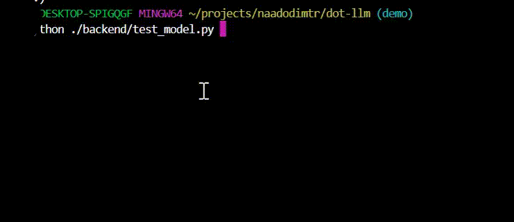

## Question ?

If all a model does is to predict next token then is it possible to build a model which always predict next token as dot *(.)* no matter what the textual input is

## DotLLM - Nothing but dots ...

DotLLM is a per‑character binary classifier (not an LLM, the name is just for being catchy) that converts text into a corresponding pattern of dots and spaces,
following the rule of one dot per character (except for spaces)

## Demo



This demo shows DotLLM in action, converting input text into patterns of dots while preserving spaces. Watch as each
character gets transformed into a single dot in real-time.

### Prerequisites

- Python 3.x

### Setting up the Environment

1. **Create a Virtual Environment**

    It's recommended to create a virtual environment to isolate the project's dependencies.

    ```bash
    python -m venv venv
    ```

2. **Activate the Virtual Environment**

    - On Windows:

      ```bash
      .\venv\Scripts\activate
      ```

    - On macOS/Linux:

      ```bash
      source venv/bin/activate
      ```

3. **Install Dependencies**

    Install the required Python packages using:

    ```bash
    pip install -r requirements.txt
    ```

### Data Generation

To generate the data required for training the model, run the following command:

```shell
  python ./model/generate_data.py
```

A file named `dot_dataset.txt` will be created.

You can modify the `num_samples`, `min_length`, `max_length`, and `include_special` variables in the script to control the size and content of the generated dataset.

### Model Training and Validation

To train the DotLLM model, use the `train.py` script. The script will train the model on the generated dataset and save the trained model.

```bash
python train.py
```

During training, the script will output the loss for each epoch.

After training is completed, model will be saved in the same folder as `dotllm_model_final.pt`

You can then copy sample inputs from `dot_dataset.txt` and remove the corresponding dot output line, and test it

# Running just the model

Run the following command

```shell
   python ./model/test_model.py
```
